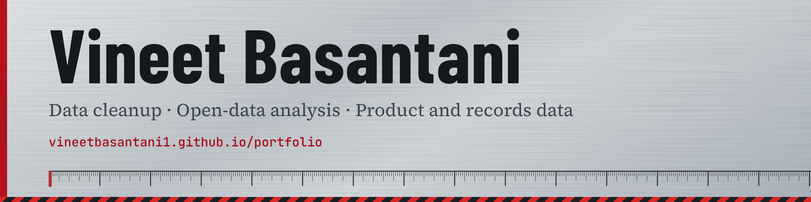

  

## About

I clean up product catalogs, part numbers and vendor records for tool and hardware businesses. I also publish open-data analysis of Canadian housing and household finance.

The audit is free: you get a short, specific write-up of what I find, with no obligation.

## Projects

| Project | What it is |
|---|---|
| [Portfolio](https://vineetbasantani1.github.io/portfolio/) | Catalog and records cleanup, with a sample before-and-after |
| [Shopify Catalog Audit Tools](https://github.com/vineetbasantani1/shopify-catalog-audit-tools) | Two Python tools that score how messy a store's product data is |
| [Data Cleanup Case Studies](https://github.com/vineetbasantani1/data-cleanup-case-studies) | Before-and-after samples of contact, inventory and survey-data cleanup |
| [Canada Property & Finance Data](https://github.com/vineetbasantani1/canada-property-finance-data) | Open-data pipeline and analysis of Canadian housing, focused on Nova Scotia, refreshed every Monday |
| [Panchang Alarm](https://github.com/vineetbasantani1/panchang-alarm-app) | Real system alarms for Hindu lunar tithis, on iOS |
